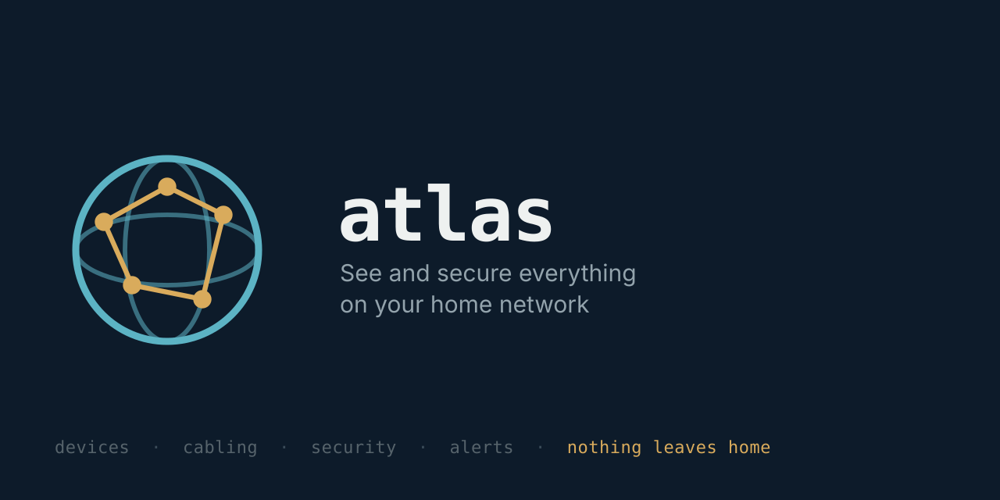
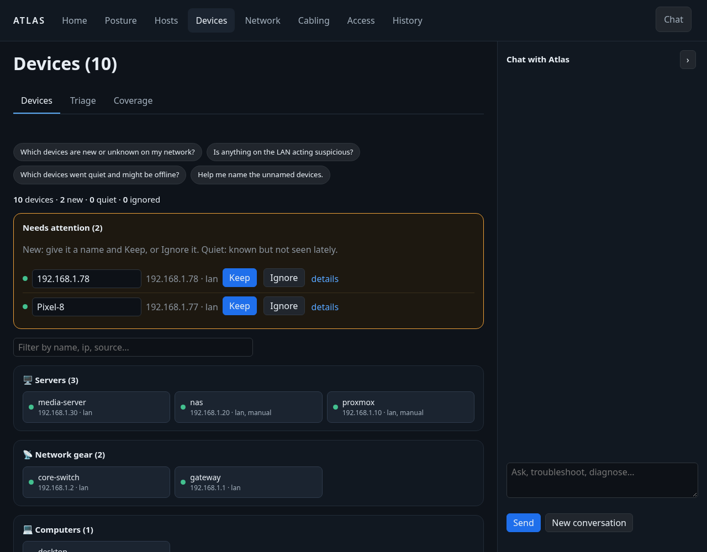
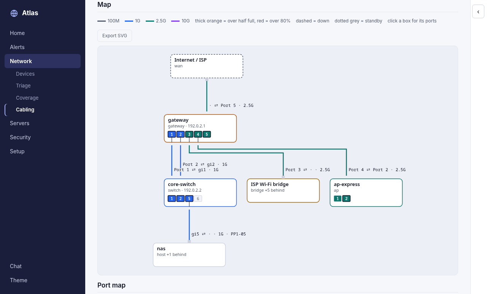
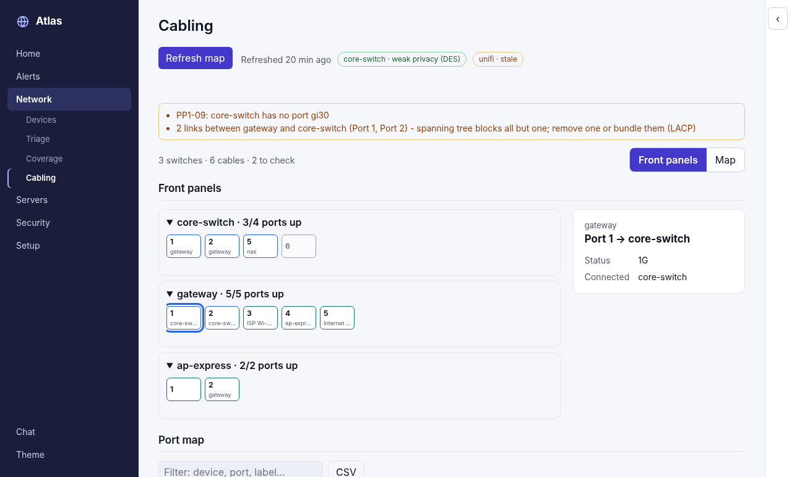

<p align="center">
  
</p>

<p align="center">
  <a href="https://github.com/Cyb3rRon1n/atlas/actions/workflows/ci.yml"></a>
  <a href="https://github.com/Cyb3rRon1n/atlas/releases/latest"></a>
  <a href="LICENSE"></a>
</p>

<p align="center">
  📖 <a href="https://cyb3rron1n.github.io/atlas/">Documentation</a> · <a href="https://cyb3rron1n.github.io/atlas/getting-started/">Getting started</a> · <a href="https://cyb3rron1n.github.io/atlas/configuration/">Configuration</a> · <a href="https://cyb3rron1n.github.io/atlas/roadmap/">Roadmap</a>
</p>

# Atlas

**Know every device on your home network, what changed, and what needs you — without sending anything to the cloud.**

Atlas is a self-hosted monitor for homelabs. It finds every machine on your LAN, maps how they're cabled together, watches your Docker containers and Proxmox guests, and tells you when something new shows up or something important goes quiet. Ask it questions in plain language and it answers from what it actually sees, using a local AI model if you like.

It never changes anything on its own. Restarting a container or a VM is only ever *suggested*, and every action asks you first.

<p align="center">
  
  <br><sub>The devices page, shown with example data.</sub>
</p>

## What it does

- **Device inventory**: every device on the LAN, found without installing anything on them. New ones wait for you to name them; important ones alert you when they drop off.
- **Network and cabling map**: a wired view from the internet down to every switch port, read over SNMP and (optionally) your UniFi console, with your patch panels added by hand.
- **Containers and VMs**: Docker containers, Proxmox and libvirt guests: what's running, what's unhealthy, and restart/stop/resize when you approve it.
- **Alerts where you already look**: ntfy, Discord, Slack, email, any webhook, Signal, or 100+ more services through Apprise.
- **Security posture**: what reaches the internet and what the internet can reach, new sign-in locations, and whether your torrent client is still behind its VPN.
- **Chat with your homelab**: "why did Jellyfin stop transcoding?" gets answered from live logs, status and your own notes, using Ollama on your hardware or Claude.

<p align="center">
  
  <br>
  <br><sub>The cabling map and switch front panels, shown with example data.</sub>
</p>

## Install

You need Linux with Docker. One line sets it up in `~/atlas` and starts it:

```bash
curl -fsSL https://raw.githubusercontent.com/Cyb3rRon1n/atlas/main/install.sh | bash
```

Prefer to read it first? `curl -fsSLO https://raw.githubusercontent.com/Cyb3rRon1n/atlas/main/install.sh`, then `less install.sh` and `bash install.sh`.

The installer asks three things (port, whether the whole LAN may open the page, and which AI to use), then prints the address. The first visit asks for a **setup code** to choose the admin password; the installer shows it, and `docker compose logs atlas` does too.

No Docker? `pip install` works as well; see [Getting started](https://cyb3rron1n.github.io/atlas/getting-started/).

## First steps

1. **Open the page** and set your password.
2. **Name your devices**: Devices → *Needs attention*. Give each new device a name and press Keep, or Ignore it.
3. **Turn on alerts**: add a channel under `notify:` in `~/atlas/atlas.yaml` (an [ntfy](https://ntfy.sh) topic is the quickest), then check it from `~/atlas` with `docker compose exec atlas atlas notify test`.
4. **Add what you have**: Proxmox, your switches (SNMP), a UniFi console, Ollama. Each one is a few lines in `atlas.yaml`, and [Configuration](https://cyb3rron1n.github.io/atlas/configuration/) has copy-paste examples.

## Privacy

**No telemetry.** Atlas never reports usage, crashes or anything else to anyone. It talks only to the things you configure (your Proxmox, switches, AI model and alert channels), plus a few optional downloads that run only when you turn the matching feature on:

- the free DB-IP city database and the iptoasn.com table, for the access and posture pages (lookups then happen on your machine);
- api.ipify.org, to compare your VPN exit address with your home address.

Everything it learns stays in one SQLite file in a Docker volume on your machine.

## Safety

- **Read-only Docker access by default.** Atlas reaches Docker through a socket proxy that only allows reads. Set `ATLAS_DOCKER_WRITE=1` in `.env` to let it restart and stop containers. That gives it full Docker control, so only do it if you want those buttons.
- **Approval for every change.** Suggested fixes are printed or shown; each step asks before it runs. There is no autonomous mode and no bypass flag.
- **Signed in by default.** The web page has its own password (or hands sign-in to Authelia/Authentik with `web.auth: proxy`). Dashboards such as Homepage use a separate read-only API token.

## FAQ

**Does it need an AI?** No. Inventory, maps, alerts and posture all work without one. The AI only powers chat and the daily check-up.

**Which AI?** A local [Ollama](https://ollama.com) model keeps everything at home (an 8B model on any 8 GB GPU is plenty). Claude is supported for heavier analysis if you have an API key.

**Do I have to install anything on my devices?** No. Discovery uses your router's and switches' own information (ARP, SNMP, LLDP) and the Docker and Proxmox APIs.

**Can it run on a Raspberry Pi?** It's plain Python, so it should, but it's only tested on x86-64 (Ubuntu in CI, Fedora in daily use).

**Can I put it on a dashboard?** Yes: [Homepage tile setup](https://cyb3rron1n.github.io/atlas/deployment/#as-a-dashboard-tile-homepage).

## Troubleshooting

| Problem | Fix |
|---|---|
| The page doesn't load | From `~/atlas`: `docker compose ps`, then `docker compose logs atlas`. By default it only listens on this machine; re-run the installer and choose "anyone on your LAN" to open it up |
| Lost the setup code or password | `docker compose exec atlas atlas auth setup-code`, or set a new password with `docker compose exec -it atlas atlas auth password` |
| No devices found | Devices are found by `atlas-scan`, which needs host networking: check `docker compose logs atlas-scan`, and set `scan.subnets` if your LAN isn't the machine's own subnet |
| Alerts don't arrive | `docker compose exec atlas atlas notify test` shows each channel's error |
| Restarting a container fails with "403" | Docker access is read-only; set `ATLAS_DOCKER_WRITE=1` in `.env` and `docker compose up -d` |

## Upgrade and uninstall

Run the installer again to upgrade: it keeps your `.env`, `atlas.yaml` and data. To remove Atlas, run `bash install.sh --uninstall`; it asks before deleting your data.

## Learn more

- [Getting started](https://cyb3rron1n.github.io/atlas/getting-started/), [Configuration](https://cyb3rron1n.github.io/atlas/configuration/), [CLI reference](https://cyb3rron1n.github.io/atlas/cli-reference/) and [Deployment](https://cyb3rron1n.github.io/atlas/deployment/) (reverse proxy, Homepage tile, posture page)
- [Architecture](https://cyb3rron1n.github.io/atlas/architecture/) and the [Roadmap](https://cyb3rron1n.github.io/atlas/roadmap/), including what has been tested against real hardware
- [Changelog](CHANGELOG.md)

## Contributing, security, license

Issues and pull requests are welcome; see [CONTRIBUTING.md](CONTRIBUTING.md). Please report security problems privately as described in [SECURITY.md](SECURITY.md). Atlas is MIT licensed.
