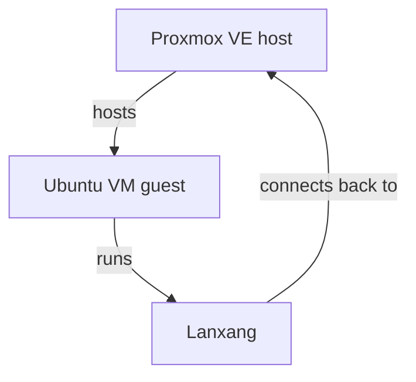

# Deployment

## The intended model

Lanxang is designed to run **as a guest on the Proxmox host it's helping you manage**, not as an external tool polling your infrastructure from somewhere else:



The typical setup:

1. Install Proxmox VE on your hardware, on a static (or DHCP-reserved) IP — Lanxang's config keys off a fixed host address, and Proxmox itself expects a stable management IP regardless.
2. Create an Ubuntu VM inside that Proxmox host.
3. Clone Lanxang into that VM, install it (`pip install -e .`), and run `lanxang init` there to generate `lanxang.yaml` — see [Getting Started](../getting-started/index.md).

Because Lanxang runs on the same cluster it inspects, connecting back to the Proxmox API is a same-network call rather than something exposed externally.

## Authentication: use a scoped API token, not the root password

Lanxang's [`proxmox` configuration](../configuration.md#proxmox) accepts either a password or an API token. **Prefer the token.** Generate one in the Proxmox UI under **Datacenter → Permissions → API Tokens** (create a dedicated user first, e.g. `atlas@pve` under the *Proxmox VE authentication server* realm, rather than tokenizing `root@pam`), and grant it a role scoped to only what Lanxang actually needs — the built-in `PVEAuditor` role is read-only and sufficient for `lanxang proxmox scan`. `lanxang proxmox restart` needs additional power-management permission on top of that — confirmed against a real Proxmox instance, granting the built-in `PVEVMUser` role (which includes `VM.PowerMgmt`) at path `/` is enough. `lanxang init` prompts for the token directly and writes it into `lanxang.yaml` for you; it does not create the token in Proxmox itself, so generate it in the UI first.

**Privilege Separation gotcha, confirmed against a real Proxmox instance**: when creating the API token, Proxmox defaults **Privilege Separation** to on, meaning the *token* (`atlas@pve!atlas-token`) has its own permission set, separate from the *user* (`atlas@pve`). Permissions granted only to the user — e.g. adding `PVEVMUser` to `atlas@pve` — do **not** apply to the token while separation is on, even though it looks like it should; `lanxang proxmox restart` will 403 with `Permission check failed (.../VM.PowerMgmt)` despite the role being correctly assigned. Either grant permissions to the token identity specifically (it's selectable in the same "User" field in **Datacenter → Permissions → Add**, listed as `atlas@pve!atlas-token`), or — simpler, and no real security loss since this is already a single-purpose account — uncheck **Privilege Separation** on the token itself (**Datacenter → Permissions → API Tokens** → edit the token) so it just inherits whatever the user has.

This isn't just caution for its own sake — it's the project's own stated principle. From `CONTRIBUTING.md`:

!!! note "Safety"
    Changes affecting infrastructure should be observable, logged, reversible whenever possible, and configurable through user approval.

Lanxang's role is to assist — observe, understand, recommend — not to require unrestricted access to operate. A least-privilege token that can be widened later is a better default than broad access you have to walk back.

## What this means for the rest of Lanxang

Every discovery path (`lanxang discover`, `lanxang proxmox scan`) feeds into the same local knowledge store and environment context, which `lanxang analyze` reads from. Nothing about the deployment model changes the trust boundary of the intelligence layer: recommendations come from Anthropic or a local Ollama model reasoning over what Lanxang observed, not from Lanxang taking action on its own.

## As a dashboard tile (Homepage)

If you run [Homepage](https://gethomepage.dev) (or any dashboard), give Lanxang a tile so the map and dashboard are one click away. Behind a reverse proxy with its own sign-in — e.g. Traefik + Authelia — set `web.auth: proxy` in `lanxang.yaml` and add a `docker-compose.override.yml` next to Lanxang's own:

```yaml
services:
  lanxang:
    ports: !reset []                 # no host port; Traefik reaches it on the shared network
    networks: [proxy]                # your Traefik network
    labels:
      - traefik.enable=true
      - traefik.http.routers.atlas.rule=Host(`atlas.example.com`)
      - traefik.http.routers.atlas.entrypoints=websecure
      - traefik.http.routers.atlas.tls=true
      - traefik.http.routers.atlas.middlewares=authelia@docker   # admins only
      - traefik.http.services.atlas.loadbalancer.server.port=8420
networks:
  proxy:
    external: true
```

Then the tile, in Homepage's `services.yaml` - with live counts from Lanxang's `/api/summary`
(a small read-only JSON view of the latest network map):

```yaml
- Infrastructure:
  - Lanxang:
      href: https://atlas.example.com/map
      icon: mdi-radar
      description: Network map, inventory, history - chat via `lanxang chat`
      siteMonitor: http://lanxang:8420
      widget:
        type: customapi
        url: http://lanxang:8420/api/summary
        refreshInterval: 60000
        headers:                       # only with web.auth: builtin - the token is `lanxang auth token`
          Authorization: Bearer {{HOMEPAGE_VAR_LANXANG_TOKEN}}
        mappings:
          - field: status
            label: Status
          - field: containers_running
            label: Containers up
          - field: hosts_up
            label: Hosts up
          - field: guests_running
            label: Guests up
          - field: { posture: message }
            label: Posture
          - field: { posture: tunnel }
            label: Tunnel
          - field: { posture: vpn }
            label: VPN
          - field: { posture: routes }
            label: Public routes
```

`/api/summary` returns `status` (`ok` / `degraded` when a map host is down or a container is
unhealthy), `containers_running`/`_total`/`_unhealthy`, `guests_running`/`_total`,
`hosts_up`/`_total`/`_down`, `ai_reachable` and `generated_at`. It also returns a `posture` object
(always present when the posture data can be read; `unknown` values until the collector has run) — `state` (`ok`/`review`/`warn`/`unknown`),
`tunnel`, `vpn`, `routes`, `blocked`, `review_count`, `message` and `link`, backing the four extra
mappings above.

Keep what the tile shows current with the `atlas-scan` container (started by default alongside
`lanxang` — nothing extra to do), or one host cron line if you're not running the compose stack:

```cron
*/30 * * * * docker exec atlas lanxang discover >/dev/null 2>&1; docker exec atlas lanxang proxmox scan >/dev/null 2>&1; docker exec atlas lanxang map >/dev/null 2>&1
```

Chat lives in the terminal: `docker exec -it atlas lanxang chat` (a one-line `atlas-chat` wrapper script on the host makes it easy to reach from an SSH/Guacamole session). If you use Authelia, make sure admin-only rules end with a `deny` rule for the same domains — a rule whose `subject` doesn't match falls through to the default policy.

## Posture page

The home page (`/`) is a posture map of what reaches the internet and what the internet can reach.
It stays empty (with a banner saying so) until `lanxang posture watch` runs - the atlas-scan container
starts it once `posture.enabled: true` is set (see the `posture:` block in `lanxang.yaml.example`).
On the Docker host:

- Byte counts need conntrack accounting: `sysctl -w net.netfilter.nf_conntrack_acct=1` (persist it in
  `/etc/sysctl.d/`). atlas-scan already has `NET_ADMIN`, used only for the read-only `conntrack -L`.
- `posture.crowdsec_api_key`: a bouncer key from `docker exec crowdsec cscli bouncers add lanxang`.
- `posture.gluetun_api_key`: an API key for gluetun's control server (an `apikey` role in its
  `config.toml`), so the VPN exit IP can be compared with the home IP.
- `posture.traefik_dynamic_dir`: Traefik's file-provider directory, mounted read-only into atlas-scan,
  so file-defined routes count toward public exposure (docker-label routes are read from the socket).
- `posture.host_ip`: the host's LAN address, so traffic from the host itself is attributed to "host".

Destinations are named by a local copy of the free iptoasn.com table (refreshed weekly); no destination
IP leaves the host except the one reverse-DNS lookup made when you open a destination's details. The
first day is a learning baseline; after that, a network a container never used before shows up under
"Needs review" until marked expected.
