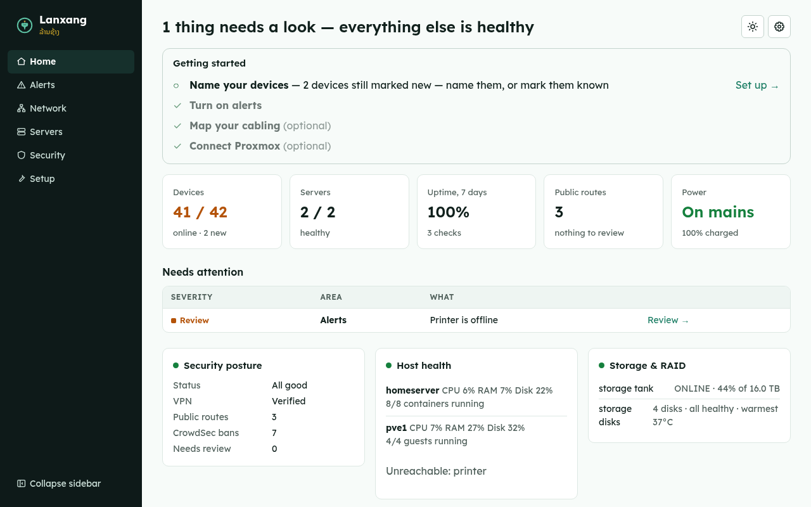

# Supported hardware

Lanxang works on **any** home network with no logins at all: it finds every device from its own LAN scan, watches
for rogue DHCP servers and spoofed gateways, lists open ports, checks your public certificates, and runs uptime
checks. Connecting your gear adds detail - switch ports, Wi-Fi access points, VMs. Everything lanxang reads is
read-only, and it never changes a device's settings.

On the **Setup** tab, *What's on your network?* asks what you have and shows only the matching cards. Gear lanxang
has already found is ticked for you.

## What works today

| You have | How lanxang reads it | What it adds | Set up on |
|---|---|---|---|
| **Any router** (ISP box, ASUS, Netgear, eero, Fritz!Box, Deco...) | Nothing to connect | Devices, DHCP/ARP watch, open ports, router port forwards via UPnP where it's on | - |
| **Managed switch** (Cisco SG/CBS, Netgear Smart, TP-Link JetStream, Zyxel GS1900, Aruba Instant On, MikroTik...) | SNMPv3, or v2c | Every port on the Cabling map: what's plugged in, speed, PoE, VLANs, spanning tree, cable health, traffic | Setup → Switches and routers |
| **Router or firewall with SNMP** (OPNsense, pfSense, OpenWrt, MikroTik RouterOS) | SNMPv3, or v2c | Its ports, links and traffic on the map | Setup → Switches and routers |
| **NAS** (Synology, QNAP, TrueNAS) | SNMPv3, or v2c | Its network ports and traffic on the map | Setup → Switches and routers |
| **Home Assistant** | A long-lived access token | Devices that dropped out, low batteries, updates waiting; alerts | Setup → Home Assistant |
| **TrueNAS or Synology** (disk health) | TrueNAS: an API key (read-only admin). Synology: an admin account with no folder or app access | Pool or volume health and use; each disk's health and temperature; alerts | Setup → TrueNAS or Synology |
| **UniFi** (gateway, switches, access points) | The console's local API, View Only account | UniFi ports and uplinks SNMP can't see, wired clients, port forwards; every client's UniFi name, Wi-Fi network, access point and signal on Devices | Setup → UniFi |
| **Proxmox VE** | API token with the PVEAuditor role | VMs and containers, drawn under their host; ZFS pools and each disk's SMART health, wear and temperature | Setup → Proxmox |
| **Docker** | A read-only socket proxy | Containers and the services they publish | `docker-compose.yml` |
| **UPS** (APC, CyberPower, Eaton... plugged into a computer or NAS) | NUT (Network UPS Tools), port 3493, read-only | Alerts on a power cut, low battery and power back; charge, time left and load | Setup → UPS |
| **Any device** (phones, TVs, speakers, printers, smart plugs...) | MAC maker list, mDNS/Bonjour, SSDP/UPnP - nothing to set up | What new devices are: maker, the name and model they announce, where they're plugged in, a suggested name | Network → Devices |
| **Pi-hole 6 or AdGuard Home** | Its web API: the password or a Pi-hole app password; AdGuard Home username + password | Ad blocking on/off (alert when it stays off), DNS questions and blocked share, the devices that ask the most | Setup → Pi-hole or AdGuard Home |
| **Your internet connection** | TCP connects to public DNS servers and your router, once a minute - nothing to set up | Up/down alerts, response time, uptime %, an outage list that says whether it was your router or your provider | Servers → Uptime |
| **Any web service or port** | HTTP or TCP | Up/down alerts, response time, uptime % | Servers → Uptime |

   
  <em>A TrueNAS mirror losing a disk, as lanxang shows it.</em>

**SNMPv3 or v2c?** Use v3 whenever the device offers it (a read-only user, SHA + AES). Many cheaper switches,
routers and NAS boxes only speak v2c: lanxang reads them with a read-only *community*, which travels unencrypted,
so give it no write access. Unmanaged switches and "Easy Smart" / "Plus" switches with no SNMP can't show their
ports - lanxang still sees every device behind them, and lists them on the port of the managed switch they hang off.

**Not supported:** mesh systems and routers that are only managed from a phone app or vendor cloud (eero,
Google/Nest Wifi, Deco, Orbi, Firewalla) have no local interface lanxang can read. Your devices still show up from
the LAN scan.

## Coming next

From our research into what homes and home labs actually run, roughly in this order:

1. **Router details** - DHCP leases and Wi-Fi clients from OPNsense, OpenWrt, MikroTik and Fritz!Box (UniFi has it already).
2. **TP-Link Omada and Unraid**, and APC network management cards read over SNMP (for a UPS with no NUT server).

Something you own missing? Open an issue with the make and model.
