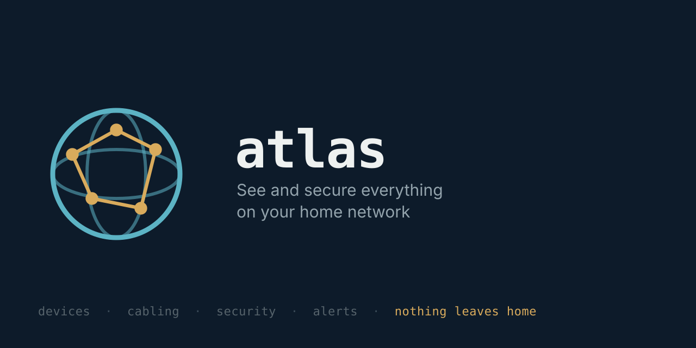
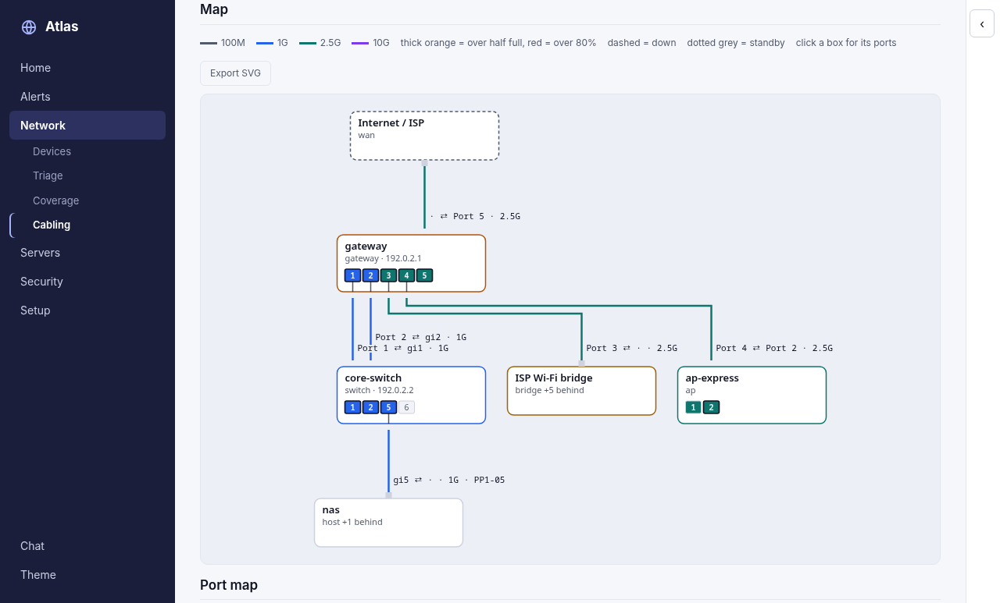
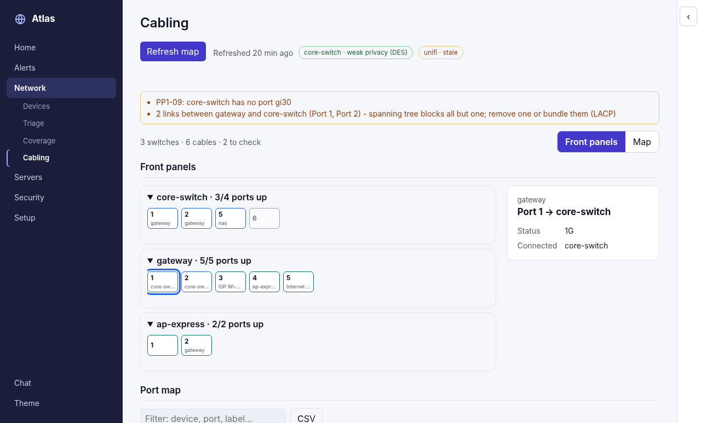
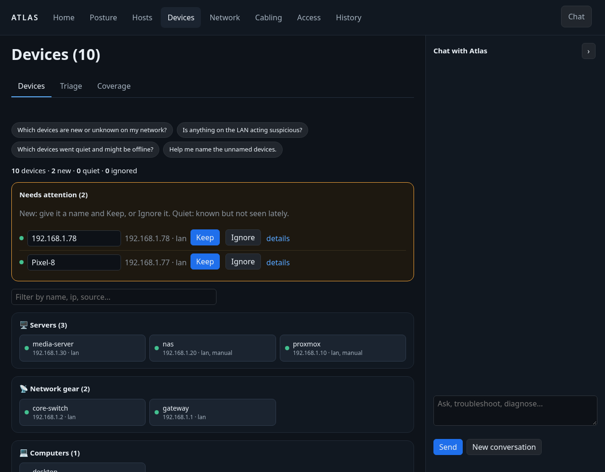
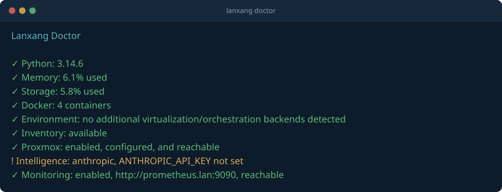
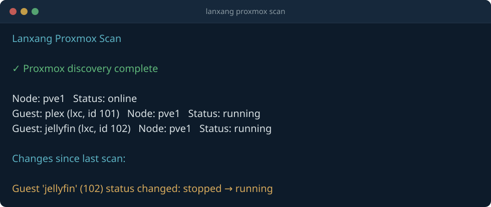
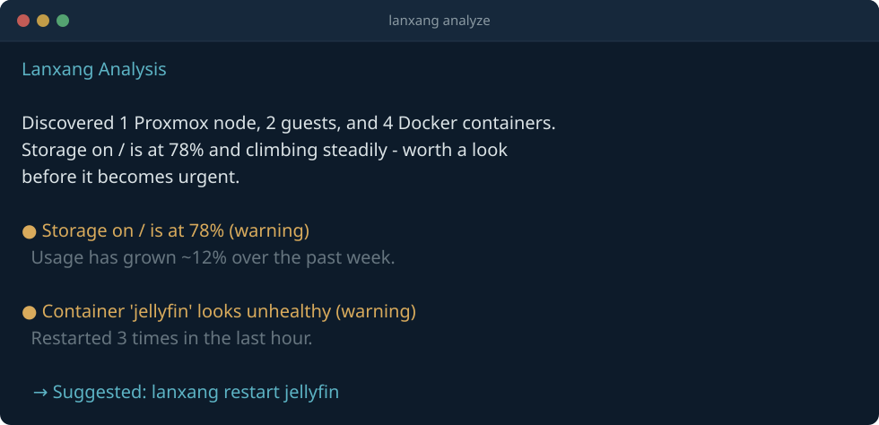
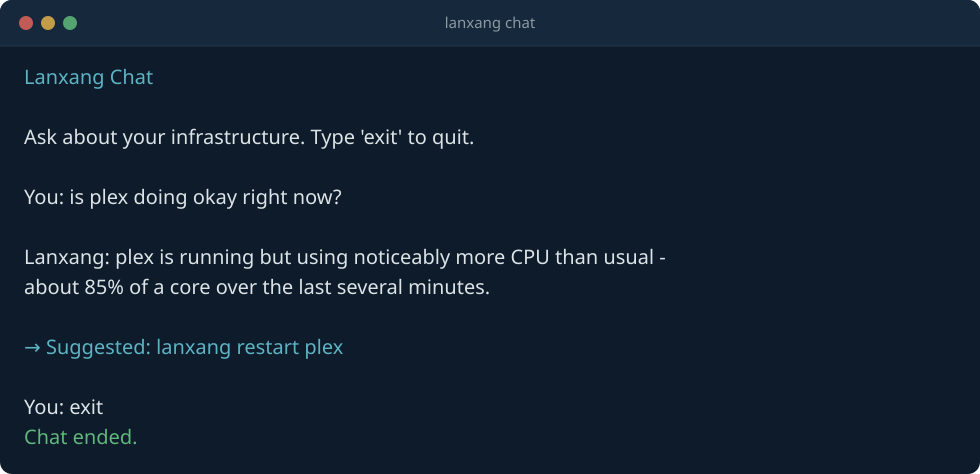
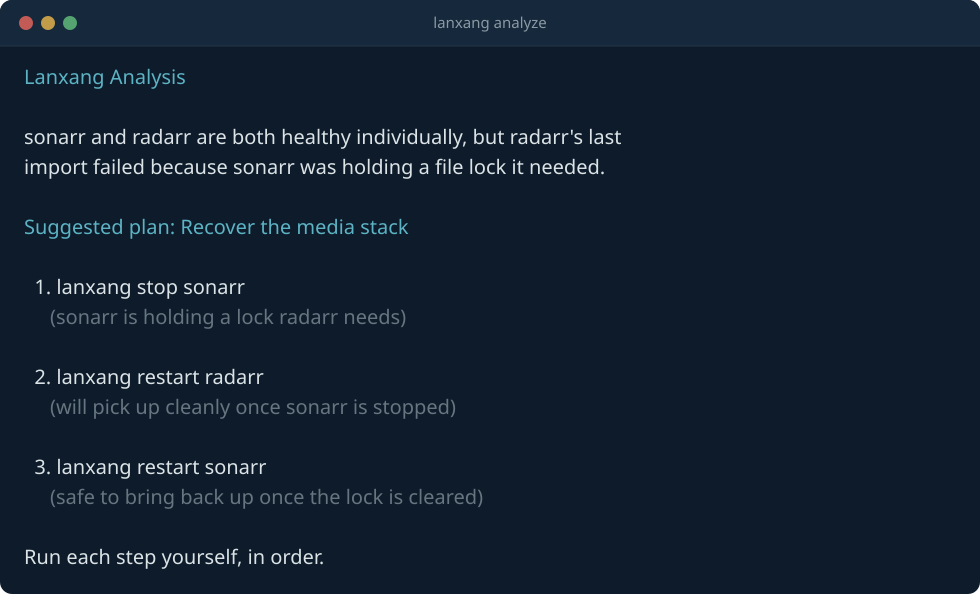
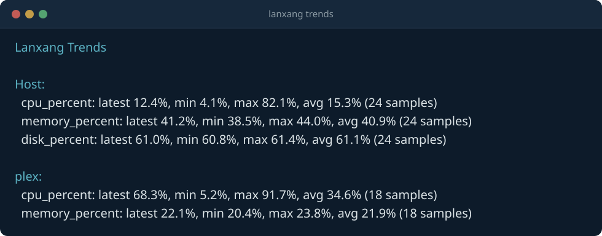

  

# Atlas

**Know every device on your home network, what changed, and what needs you — without sending anything to the cloud.**

Atlas is a self-hosted watchdog for homelabs. It finds every machine on your LAN without installing anything on
them, maps how they are cabled together down to the switch port, watches your Docker containers and Proxmox
guests, checks your network's security, and alerts you when something new shows up or something important goes
quiet. An AI model is optional: run one locally with Ollama and ask questions in plain language.

!!! quote "Watch everything. Change nothing without asking."
    Atlas observes and explains. Restarting a container or a VM is only ever suggested, and every action asks you
    first. There is no autonomous mode and no bypass flag.

## What Atlas does

- **Device inventory**: every device on the LAN, found from ARP, SNMP and LLDP. New ones wait for you to name them;
  important ones alert you when they drop off.
- **Cabling map**: a wired view from the internet down to every switch port — link speeds, PoE, spanning tree,
  link bundles, VLANs and your patch panels — read over SNMP and (optionally) your UniFi console.
- **Security watch**: new open ports on LAN devices, a rogue DHCP server, ARP spoofing of your gateway, expiring
  TLS certificates, what reaches the internet and what the internet can reach, and whether your torrent client is
  still behind its VPN.
- **Health**: cable errors, temperatures near their limit, full disks, crashed or restart-looping containers.
- **Alerts where you already look**: ntfy, Discord, Slack, email, any webhook, Signal, or 100+ services through
  Apprise. One alert when a problem starts, one when it clears.
- **Containers and VMs**: Docker, Proxmox and libvirt — what's running, what's unhealthy, and restart, stop or
  resize when you approve it.
- **Chat with your homelab** (optional): answers come from live state, logs and your own notes, using Ollama on
  your own hardware or Claude.

Start with [Getting Started](getting-started/index.md), or see [Architecture](architecture/index.md) for how the
pieces fit together.

## See it in action

   
   
  The Cabling page, shown with example data.

   
  The Devices page, shown with example data.

### From the terminal

Representative output, not a literal capture — field names and formatting match real commands; hostnames, containers, and figures are illustrative.

   
  <code>atlas doctor</code> — environment health plus integration readiness

   
  <code>atlas proxmox scan</code> — cluster inventory and change detection since the last scan

   
  <code>atlas analyze</code> — AI summary with a grounded, approval-gated action suggestion

   
  <code>atlas chat</code> — a live conversation, grounded the same way as <code>atlas analyze</code>

   
  A suggested multi-step plan — printed for you to run yourself, one step at a time

   
  <code>atlas trends</code> — resource-usage history built from saved <code>atlas monitor</code> snapshots

## Where this is headed

Atlas isn't meant to run on your laptop and poke at infrastructure from the outside — see [Deployment](deployment/index.md) for the intended model of Atlas running as a guest on the Proxmox host it's helping you manage. The [Roadmap](roadmap.md) covers what's shipped and what's next.
